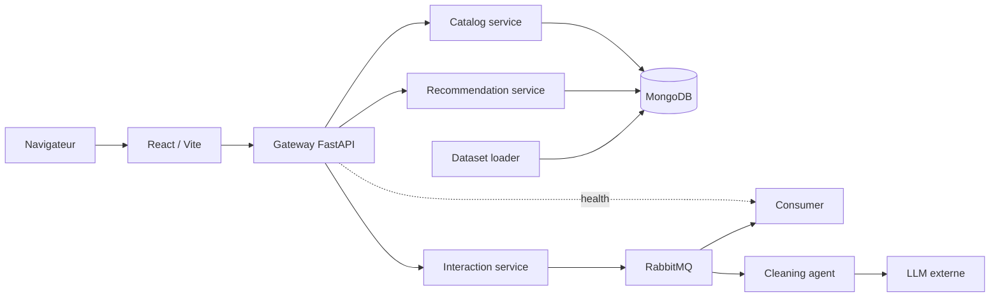

# Architecture initiale

## Vue d’ensemble

Les flux de catalogue et de critiques sont implémentés. Le nettoyage et les
recommandations restent hors périmètre; aucun appel au LLM n’est effectué.

## Réseaux et exposition

- `frontend_gateway` : frontend et gateway seulement, réseau interne. Le frontend
  ne peut ni résoudre MongoDB/RabbitMQ ni accéder aux réseaux de données.
- `host_ingress` : frontend et gateway uniquement; permet la publication de
  leurs ports HTTP sur l’hôte, sans connecter le frontend aux réseaux de données.
- `backend` : gateway, services HTTP internes et endpoint de santé du consumer;
  MongoDB et RabbitMQ n’y sont pas attachés.
- `data` : MongoDB, services catalogue/recommandation, consumer et chargeur.
- `messaging` : RabbitMQ, interaction-service, cleaning-agent et consumer.
- `llm_egress` : seule sortie réseau externe du cleaning-agent.

MongoDB est uniquement sur `data`, RabbitMQ uniquement sur `messaging`. Seuls le
frontend et la gateway publient des ports sur l’hôte. Les services accèdent à
leurs dépendances via les noms DNS Compose. Les services Python sont configurés
avec ces URL et des healthchecks; les dépendances attendent les healthchecks ou
la fin du chargement des données.

## MongoDB et dataset

MongoDB utilise l’image officielle épinglée et un volume persistant. Le script
`dataset/mongo-init.sh` est monté dans `/docker-entrypoint-initdb.d/` et s’exécute
à la première initialisation du volume. Il crée les index et des comptes
applicatifs dédiés. Le service ponctuel `dataset-loader` réconcilie comptes et
index aux démarrages suivants.

Le chargeur lit les fichiers `.json` et `.json.gz` placés à la racine de
`dataset/` (JSON Lines, tableaux JSON et Extended JSON MongoDB). Il utilise des
upserts par `_id` et un manifeste SHA-256 pour ne pas réimporter un fichier
inchangé. Le volume du dataset est monté en lecture seule et les archives
sources ne sont pas modifiées.

Les archives `movies.json.gz` et `reviews.json.gz` présentes dans cette copie
sont importées automatiquement. En l’absence de données, un avertissement est
journalisé sans créer de faux contenu. Cet import brut ne réalise aucun
nettoyage sémantique; celui-ci ne peut être considéré comme terminé avant
l’exécution et la validation d’un traitement dédié sur le dataset réel.

Les comptes MongoDB root sont réservés au bootstrap et au chargeur. Le service
catalogue et le service de recommandation ont des comptes en lecture seule; le
consumer a un compte lecture-écriture.

## RabbitMQ

RabbitMQ utilise l’image officielle épinglée, un volume persistant et la
configuration `rabbitmq/rabbitmq.conf`, qui charge automatiquement
`rabbitmq/definitions.json`. Celle-ci déclare l’exchange topic durable
`dcic.events`, les routes des votes, critiques et demandes de nettoyage, ainsi
que leurs queues durables et queues de lettres mortes. Aucun endpoint, exchange,
queue ou binding ne demande de création manuelle.

## Responsabilités des services

- **Frontend** : React/TypeScript et Vite; requêtes via la gateway publiée.
- **Gateway** : point d’entrée HTTP; valide les entrées, relaie les routes de
  catalogue/critiques et agrège l’état de santé des services HTTP.
- **Catalog service** : recherche, filtre genre, pagination, détails et critiques
  historiques depuis MongoDB; les courriels ne sont jamais renvoyés.
- **Cleaning agent** : futur traitement LLM et consommation des événements; le
  SDK OpenAI est prévu, avec la clé fournie par variable d’environnement.
- **Recommendation service** : futur TF-IDF et similarité cosinus sur les
  données MongoDB.
- **Interaction service** : valide notes et commentaires, publie des événements
  persistants confirmés par RabbitMQ et n’accède pas à MongoDB.
- **Consumer** : valide les événements de critique, les écrit idempotemment dans
  MongoDB et acquitte seulement après la réussite de la persistance.
- **Dataset loader** : import idempotent des sources du dataset et synchronisation
  des comptes applicatifs/indexes au démarrage.

Les services redémarrent avec `unless-stopped`; le chargeur ponctuel ne redémarre
qu’en cas d’échec. Les volumes MongoDB et RabbitMQ survivent aux redémarrages.
Les variables locales sont documentées dans `.env.example`; les identifiants
d’exemple doivent être remplacés avant tout déploiement partagé.

## Flux d’interaction

1. Le navigateur envoie ses requêtes à la gateway.
2. La gateway délègue la recherche et la lecture au service catalogue.
3. La gateway transmet les nouvelles critiques au service interaction.
4. Le service interaction publie sur `dcic.events` avec la routing key
   `interaction.review.created`; RabbitMQ confirme le message persistant.
5. Le consumer récupère `interactions.reviews`, valide le contrat, écrit un
   document d’`_id` égal à l’identifiant d’événement puis acquitte le message.
   Une erreur MongoDB provoque un nack avec requeue; un message invalide est
   rejeté vers la dead-letter queue.
6. La gateway vérifie le catalogue, l’interaction, le consumer et la
   recommandation via `/api/health`. Le healthcheck local `/health` ne vérifie
   que la gateway.

Voir [contracts.md](contracts.md) pour les schémas HTTP et événements.
