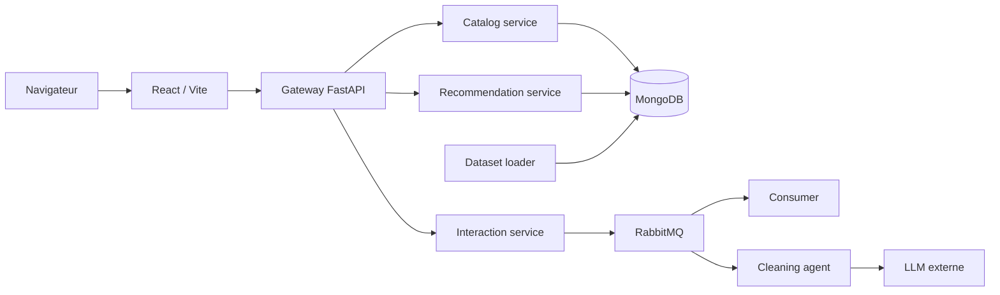

# Architecture initiale

## Vue d’ensemble

Cette vue décrit les responsabilités visées, pas des flux métier déjà
implémentés. Les services HTTP fournissent uniquement `/health`; le consumer
reste inactif et aucun appel au LLM n’est effectué.

## Réseaux et exposition

- `frontend_gateway` : frontend et gateway seulement, réseau interne. Le frontend
  ne peut ni résoudre MongoDB/RabbitMQ ni accéder aux réseaux de données.
- `backend` : gateway et services HTTP internes; MongoDB et RabbitMQ n’y sont
  pas attachés.
- `data` : MongoDB, services catalogue/recommandation, consumer et chargeur.
- `messaging` : RabbitMQ, interaction-service, cleaning-agent et consumer.
- `llm_egress` : seule sortie réseau externe du cleaning-agent.

MongoDB est uniquement sur `data`, RabbitMQ uniquement sur `messaging`. Seuls le
frontend et la gateway publient des ports sur l’hôte. Les services accèdent à
leurs dépendances via les noms DNS Compose. Les services Python sont configurés
avec ces URL et des healthchecks; les dépendances attendent les healthchecks ou
la fin du chargement des données.

## MongoDB et dataset

MongoDB utilise l’image officielle épinglée et un volume persistant. Le script
`dataset/mongo-init.sh` est monté dans `/docker-entrypoint-initdb.d/` et s’exécute
à la première initialisation du volume. Il crée les index et des comptes
applicatifs dédiés. Le service ponctuel `dataset-loader` réconcilie comptes et
index aux démarrages suivants.

Le chargeur lit les fichiers `.json` et `.json.gz` placés à la racine de
`dataset/` (JSON Lines, tableaux JSON et Extended JSON MongoDB). Il utilise des
upserts par `_id` et un manifeste SHA-256 pour ne pas réimporter un fichier
inchangé. Le volume du dataset est monté en lecture seule et les archives
sources ne sont pas modifiées.

Les archives `movies.json.gz` et `reviews.json.gz` présentes dans cette copie
sont importées automatiquement. En l’absence de données, un avertissement est
journalisé sans créer de faux contenu. Cet import brut ne réalise aucun
nettoyage sémantique; celui-ci ne peut être considéré comme terminé avant
l’exécution et la validation d’un traitement dédié sur le dataset réel.

Les comptes MongoDB root sont réservés au bootstrap et au chargeur. Le service
catalogue et le service de recommandation ont des comptes en lecture seule; le
consumer a un compte lecture-écriture.

## RabbitMQ

RabbitMQ utilise l’image officielle épinglée, un volume persistant et la
configuration `rabbitmq/rabbitmq.conf`, qui charge automatiquement
`rabbitmq/definitions.json`. Celle-ci déclare l’exchange topic durable
`dcic.events`, les routes des votes, critiques et demandes de nettoyage, ainsi
que leurs queues durables et queues de lettres mortes. Aucun endpoint, exchange,
queue ou binding ne demande de création manuelle.

## Responsabilités des services

- **Frontend** : React/TypeScript et Vite; requêtes via la gateway publiée.
- **Gateway** : point d’entrée HTTP; URL Compose des trois services HTTP
  configurées par variables d’environnement.
- **Catalog service** : futur accès en lecture au catalogue MongoDB.
- **Cleaning agent** : futur traitement LLM et consommation des événements; le
  SDK OpenAI est prévu, avec la clé fournie par variable d’environnement.
- **Recommendation service** : futur TF-IDF et similarité cosinus sur les
  données MongoDB.
- **Interaction service** : futur point d’entrée pour votes/critiques et
  publication RabbitMQ.
- **Consumer** : futur traitement des messages RabbitMQ et persistance MongoDB.
- **Dataset loader** : import idempotent des sources du dataset et synchronisation
  des comptes applicatifs/indexes au démarrage.

Les services redémarrent avec `unless-stopped`; le chargeur ponctuel ne redémarre
qu’en cas d’échec. Les volumes MongoDB et RabbitMQ survivent aux redémarrages.
Les variables locales sont documentées dans `.env.example`; les identifiants
d’exemple doivent être remplacés avant tout déploiement partagé.

## Flux cible

1. Le navigateur envoie ses requêtes à la gateway.
2. La gateway délègue au service responsable de la ressource.
3. Les interactions publieront des événements dans RabbitMQ.
4. Le consumer et le cleaning agent traiteront les événements adaptés.
5. Le chargeur importe les fichiers du dataset dans MongoDB; le service de
   recommandation utilisera ensuite les données textuelles.

Les contrats HTTP, événements, politiques de reprise et schémas MongoDB restent
à définir avant d’implémenter ces flux métier.
