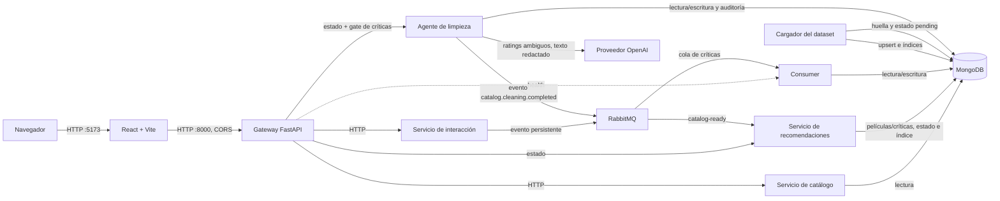

# Arquitectura y operación

Este documento describe lo que la configuración y el código actuales hacen,
separándolo de las funciones previstas. Antes de cambiar límites o dependencias,
el equipo debe revisar esta propuesta y confirmar las decisiones en
[decisions.md](decisions.md).

## 1. Vista general



Las líneas discontinuas indican una comprobación de salud. El agente de
limpieza aplica normalizaciones deterministas, registra cada cambio y usa
OpenAI únicamente para ratings ausentes o inválidos con comentario útil. Tras
el evento confirmado de catálogo listo, el recomendador construye un índice
TF-IDF/coseno versionado y sirve recomendaciones personalizadas y películas
similares desde sus datos precalculados.

## 2. Servicios y propiedad de los datos

| Servicio | Responsabilidad actual | Datos/dependencias |
| --- | --- | --- |
| `frontend` | Interfaz española; envía solicitudes HTTP a la gateway | Solo gateway; perfil local sin autenticación |
| `gateway` | Valida las solicitudes públicas, reenvía HTTP y agrega healthchecks | Servicios HTTP internos; no se conecta a MongoDB ni RabbitMQ |
| `catalog-service` | Busca, filtra, pagina y serializa películas y críticas | Cuenta de MongoDB de solo lectura |
| `interaction-service` | Valida y publica críticas como eventos confirmados | RabbitMQ; no escribe en MongoDB |
| `consumer` | Valida mensajes de crítica y los persiste de manera idempotente | MongoDB de lectura/escritura y RabbitMQ |
| `dataset-loader` | Carga archivos admitidos y reconcilia cuentas e índices | Cuenta administrativa de MongoDB; trabajo de inicialización |
| `cleaning-agent` | Pipeline de limpieza, auditoría durable, estado y publicación de catálogo listo | Escritura limitada a películas, críticas y colecciones de pipeline/auditoría; OpenAI por entorno |
| `recommendation-service` | Construye y persiste vecinos TF-IDF/coseno, agrega preferencias del perfil y expone recomendaciones y películas similares | Lectura de películas/críticas; escritura limitada a estado e índice; RabbitMQ |
| `mongodb` | Almacén persistente del catálogo y las críticas | Solo red `data` |
| `rabbitmq` | Broker, exchange, colas, bindings y colas de mensajes fallidos | Solo red `messaging` |

Cada servicio HTTP tiene un `Dockerfile` y un `requirements.txt` propios. Las
dependencias runtime corresponden al código que ejecuta ese servicio; el agente
usa HTTP para OpenAI y el recomendador usa RabbitMQ para recibir el evento.

## 3. Redes y límites de confianza

Compose conecta los contenedores a redes distintas para limitar qué nombres
puede resolver cada servicio:

| Red Compose | Miembros | Finalidad |
| --- | --- | --- |
| `frontend_gateway` (interna) | `frontend`, `gateway` | Comunicación HTTP entre navegador del contenedor y gateway |
| `host_ingress` (no interna) | `frontend`, `gateway` | Publicar los puertos HTTP 5173 y 8000 en el host |
| `backend` (interna) | `gateway`, servicios HTTP internos | Reenvío HTTP entre servicios |
| `data` (interna) | `mongodb`, `dataset-loader`, catálogo, recomendaciones, consumer, cleaning-agent | Acceso a MongoDB |
| `messaging` (interna) | `rabbitmq`, `rabbitmq-init`, interacción, consumer, cleaning-agent, recommendation-service | Acceso a RabbitMQ |
| `llm_egress` (no interna) | `cleaning-agent` | Salida del agente hacia OpenAI |

MongoDB no pertenece a `frontend_gateway`, `host_ingress` ni `backend`; RabbitMQ
tampoco. El frontend comparte con la gateway el segmento de entrada del host,
pero no una red con los servicios de datos. Por eso el navegador usa el puerto
HTTP de la gateway y no el DNS ni el puerto de MongoDB o RabbitMQ.

**Límite importante:** el aislamiento de redes Docker reduce la conectividad,
pero no es autenticación, cifrado TLS ni una política de firewall del host. La
red `host_ingress` y `llm_egress` no son `internal`; el frontend puede necesitar
esa conexión de salida para publicar el servidor de desarrollo. Revisa las
redes y los puertos efectivos con `docker inspect` y `Test-NetConnection`; no
infieras la seguridad únicamente de los nombres en Compose.

Solo se publican los puertos de la gateway y de Vite en el host. Los puertos de
MongoDB y RabbitMQ no tienen asignación `ports:`. El panel de administración de
RabbitMQ tampoco se publica.

## 4. Flujo síncrono: lectura del catálogo

1. El navegador consulta una ruta `/api/...` en el puerto de la gateway.
2. La gateway valida los parámetros y envía la solicitud al servicio adecuado.
3. El catálogo consulta MongoDB con su cuenta de solo lectura, transforma los
   valores no serializables y devuelve la respuesta.
4. La gateway retransmite el resultado sin abrir una conexión de base de datos
   desde el frontend.

La búsqueda textual examina `title`, `plot` y `fullplot`; el filtro por género
compara una entrada del arreglo `genres`. Los resultados usan paginación con
un máximo de 100 elementos por página. Los detalles del contrato público están
en [contracts.md](contracts.md).

La interfaz actual obtiene las opciones de género a partir de una muestra
paginada, pues no existe una ruta de géneros distintos. Por ello, no se debe
presentar esa lista como exhaustiva. El selector de orden actual reordena los
elementos de la página visible en el navegador; el servidor todavía no ordena
globalmente por año o nota. Una implementación global requiere ampliar y probar
el contrato de catálogo.

## 5. Flujo asíncrono: creación de una crítica

1. La interfaz envía `movie_id`, `user_id`, `rating` y `comment` a la gateway.
2. Antes de reenviar, la gateway consulta el estado de limpieza y rechaza con
   `503` si el catálogo todavía no está `ready`.
3. Gateway e interaction-service validan los límites del contrato. Repetir
   validaciones en ambos límites es deliberado: ambos servicios deben poder
   rechazar una solicitud inválida aunque se llamen por separado.
4. Interaction-service publica un mensaje persistente en `dcic.events` con la
   clave `interaction.review.created` y espera la confirmación del broker.
5. RabbitMQ enruta el evento a `interactions.reviews`.
6. El consumer valida de nuevo el evento y hace un upsert en `reviews` con
   `_id = event_id`.
7. El consumer confirma el mensaje solo después de persistir correctamente.
   MongoDB inaccesible produce reencolado; un mensaje inválido se rechaza hacia
   la cola de mensajes fallidos.

La definición del evento se repite en productor y consumidor para que cada
límite pueda validar mensajes de forma independiente. La evolución debe
mantener compatibilidad y sincronizar las pruebas y el contrato, no eliminar
esa validación independiente.

## 6. MongoDB y carga del dataset

### Inicialización

`mongodb` usa la imagen oficial fijada en `docker-compose.yml`, un volumen
persistente y `dataset/mongo-init.sh` montado en
`/docker-entrypoint-initdb.d/`. Mongo ejecuta ese script al crear por primera
vez un volumen vacío. El script crea:

- una cuenta de lectura para el catálogo;
- una cuenta que lee el catálogo y las críticas, y solo escribe el estado y los
  documentos de índice del servicio de recomendaciones;
- una cuenta de lectura y escritura para el consumer;
- un rol limitado para `cleaning-agent`, definido por colección;
- índices de catálogo y críticas.

Como el punto de entrada de Mongo solo ejecuta esos scripts en la primera
inicialización, `dataset-loader` vuelve a reconciliar cuentas e índices en los
arranques posteriores. La cuenta root queda reservada al bootstrap y la carga;
las contraseñas salen de variables de entorno.

### Formatos e idempotencia

El cargador procesa archivos `.json` y `.json.gz` en la raíz de `dataset/`,
incluyendo JSON Lines, arreglos JSON y Extended JSON de MongoDB según su
implementación actual. Los documentos necesitan `_id`. El archivo de origen se
monta como solo lectura y el cargador compara un hash SHA-256 antes de volver a
procesarlo; aplica upserts por `_id`.

Los archivos suministrados en esta copia son `movies.json.gz` y
`reviews.json.gz`. La carga inicial conocida contiene aproximadamente 19 842
películas y 61 488 críticas; verifica los recuentos en la instancia antes de
usar cifras en una presentación, porque la fuente puede cambiar.

La carga preserva los archivos de origen y **no** equivale a detectar ni
corregir anomalías. Después de cargar, registra una huella estable en
`_catalog_pipeline` y marca la limpieza como `pending` cuando cambia la fuente o
`CLEANER_VERSION`. El perfil estructural reproducible está en
[data-profile.md](data-profile.md). No interpretes una importación correcta
como una confirmación de calidad.

### Estado durable, limpieza y auditoría

`cleaning-agent` reclama `_catalog_pipeline/catalog` mediante una actualización
atómica y un lease renovable. Normaliza años, duración, géneros, ratings IMDb,
fechas y ratings de críticas; descarta marcadores de spam y referencias huérfanas,
redirige críticas al registro canónico y elimina duplicados exactos/conservadores.
Las críticas ambiguas se envían a OpenAI en lotes, sin identificadores, correos,
URLs ni teléfonos; los resultados de baja confianza quedan sin inferir y se
registran explícitamente.

Cada cambio queda en `_cleaning_audit_details`; el resumen con métricas, conteos
y huella queda en `_cleaning_audit_runs`. Los documentos de auditoría omiten
`user_email` y `user_id`, y el texto usado en detalles se redacta. La gateway
expone `GET /api/status`, `GET /api/audit/runs` y los detalles paginados. La
gateway permite crear críticas solo cuando la limpieza está `ready`.

El estado pasa a `ready` solo después de persistir datos e informe. Un evento
persistente y confirmado `catalog.cleaning.completed` se publica a
`recommendations.catalog-ready`; si MongoDB no registra el envío, el mismo
`event_id` se vuelve a publicar. El recomendador comprueba el evento y el estado
durable, crea vecinos TF-IDF/coseno y solo marca `ready` tras persistir el lote
completo. El identificador del índice incluye la huella y las versiones de
limpieza y recomendación; un reinicio reutiliza el índice vigente. El servicio
expone recomendaciones por perfil y películas similares sin recalcular el
catálogo en cada petición.

## 7. RabbitMQ y topología

RabbitMQ usa una imagen oficial fijada, volumen persistente, configuración en
`rabbitmq/rabbitmq.conf` y definiciones declarativas en
`rabbitmq/definitions.json`. Estas últimas crean automáticamente:

- exchange topic durable `dcic.events`;
- exchange durable `dcic.events.dlx` para mensajes fallidos;
- colas `interactions.reviews`, `interactions.votes`, `catalog.cleaning` y
  `recommendations.catalog-ready`;
- una cola durable de mensajes fallidos para cada una de esas colas;
- bindings para críticas, votos, solicitudes de limpieza y catálogo listo.

La cola `catalog.cleaning` sigue siendo una cola de solicitudes preparada; el
evento de finalización sí tiene publicador y consumidor. Cuando el volumen
conserva credenciales anteriores, `rabbitmq-init` espera el healthcheck del broker y reconcilia
usuario y permisos antes de iniciar los servicios dependientes. Utiliza el
volumen de datos existente en modo de solo lectura y no reinicializa el broker.

## 8. Healthchecks, dependencias y reinicio

Los servicios HTTP ofrecen `/health`; los healthchecks de Compose comprueban que
el proceso web responda. La gateway consulta el estado de los servicios que
conoce mediante `/api/health`. Un servicio puede responder a `/health` sin tener
implementada toda la lógica de negocio: un estado `ok` significa que el proceso
está disponible, no que la limpieza o las recomendaciones ya funcionen.

`depends_on` con condiciones de salud o de finalización fija el orden inicial;
el lease, el estado persistente y los reintentos cubren los pipelines de
limpieza e indexación.
La mayoría de servicios persiste con `unless-stopped`; el cargador y
`rabbitmq-init` son tareas puntuales.

## 9. Seguridad, secretos y límites conocidos

- La gateway es el único API que utiliza el frontend. Nunca añadas una
  conexión MongoDB, RabbitMQ o clave del LLM al bundle del navegador.
- Los perfiles del frontend solo generan un identificador local. No hay
  autenticación, autorización, sesiones verificadas ni protección contra
  suplantación; este sistema no es apto para publicar críticas en producción.
- Las credenciales de `.env.example` no son secretos de producción.
- El consumidor de mensajes es dueño de la escritura de críticas; el servicio
  de interacción no obtiene permisos de escritura en MongoDB.
- La red no sustituye TLS, rotación de claves, límites de tasa ni un análisis
  de las imágenes y dependencias.
- El endpoint de salud de recomendaciones no demuestra que el índice esté
  listo. El estado de negocio se consulta en `/api/status`; las rutas de
  recomendaciones devuelven `503` hasta que la huella y las versiones activas
  coincidan con el catálogo listo.

## 10. Cómo comprobar y desarrollar cambios

### Comprobaciones de la pila

```powershell
docker compose config -q
docker compose ps
docker compose logs --tail 100 gateway catalog-service interaction-service consumer
Invoke-RestMethod http://localhost:8000/api/health
Invoke-RestMethod "http://localhost:8000/api/movies?page_size=1"
```

Comprueba también en Docker que el frontend no resuelve `mongodb` ni
`rabbitmq`, como se muestra en el README. Para comprobar un cambio de flujo,
ejercita la API y confirma que el evento termina en la base de datos; una
respuesta HTTP de éxito por sí sola no prueba persistencia.

### Pruebas automatizadas

Desde la raíz, con Python 3.13:

```powershell
py -3.13 -m venv .venv
.\.venv\Scripts\Activate.ps1
python -m pip install -r gateway\requirements-dev.txt -r catalog-service\requirements-dev.txt -r interaction-service\requirements-dev.txt -r consumer\requirements-dev.txt -r recommendation-service\requirements.txt
python -m pytest -q
```

Para el frontend, desde `frontend/`, ejecuta `npm ci` y `npm run build`.
Describe en el cambio qué criterio mide cada prueba y qué escenario real todavía
no cubre.

### Cambios de arquitectura o contrato

Antes de cambiar un límite, prepara con el equipo un diagrama o secuencia y el
contrato afectado. Actualiza el productor, el consumidor, las pruebas, el
frontend si corresponde, el Compose y esta documentación en el mismo cambio
lógico. Comprueba el diff y pide a otra persona que lo explique antes de
integrarlo; Git por sí solo no garantiza esa revisión.
